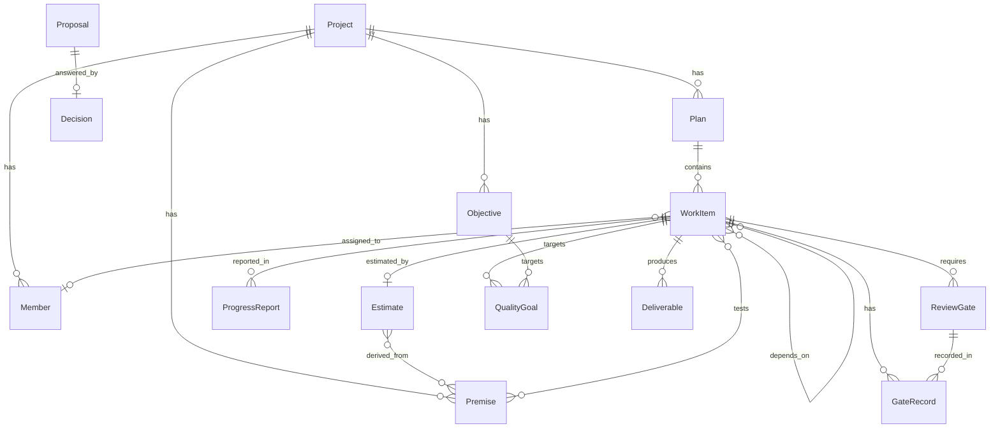

# 共通モデル

ハーネスが管理するプロジェクトの概念・関係・状態・不変条件。

## 前提

- 利用者はプロジェクトリーダー 1 人。ハーネスへの入力はすべてリーダーから来る。
- 状態を変える主体は 2 つしかない。
  - **リーダー**: 事実の入力、提案への回答、承認。
  - **ハーネス（LLM）**: 分析と提案。プロジェクトの約束事（計画・制約・品質目標・ゲート）を自分では変えられない。

## 概念

### プロジェクトと目的
| 概念 | 内容 |
|---|---|
| Project | 名前、現在のフェーズ（企画／計画／推進／終了）、企画の骨子（問題意識・方向性・範囲） |
| Objective | 達成したいこと。企画で問題意識・暫定的な方向性から磨く。達成状況を持つ |

### 前提と推定
| 概念 | 内容 |
|---|---|
| Premise | リーダーが述べた条件や、計画が依拠する前提。種類は「制約」か「仮定」。仮定は検証状態（未検証／支持／棄却）を持つ |
| Estimate | フェルミ推定・規模推定・工数見積。値（幅）、導出の式、入力（Premise・別の Estimate・リーダーの発言の引用・エージェントの仮置き） |

計画要素の 4 分類は、制約と仮定を Premise の種類、推定を Estimate、決定を Decision で表す。

### 人と計画
| 概念 | 内容 |
|---|---|
| Member | 名前、役割、能力の想定、稼働（リーダーの言葉と、週の稼働日の数）、不在の期間。利用者ではなくデータ。能力の想定は、推定の係数として扱う |
| Plan | 期限と WorkItem の集合と、置き換える Plan。再計画では新しい Plan が旧 Plan を置き換える。見通し（完了見込みと人ごとの負荷）は記録せず、そのつど計算する |
| WorkItem | 担当 Member、Estimate、待ちの営業日、チェックポイント（区切りと、通過後に残る工数）、依存先 WorkItem、種類（実行／探索）、生む成果物の種類（0 個以上）、状態 |

実行型・探索型は WorkItem ごとに選ぶ。実行型と探索型が混在するプロジェクトをそのまま表せる。
探索型の WorkItem は、検証する仮定（Premise）を持つ。結論は WorkItem には持たせず、確かめた仮定の検証状態（支持／棄却。未決は未検証のまま覚え書きを付ける）で表す（2026-10-13、`PHASE-EXECUTING.md`「決めたこと」4）。仮説が棄却されても作業は完了であり、失敗とは扱わない。棄却された仮定を確かめた探索型に依存する未完了の WorkItem は、見直しが要るものとして示す。

改訂版という概念はない。既存の成果物を改める作業は別の WorkItem として計画し、別の成果物として提出する。元の WorkItem との関係は依存先で表す。

### 推進
| 概念 | 内容 |
|---|---|
| ProgressReport | リーダーが入力する進捗。対象 WorkItem、日付、内容、残りの工数、通過したチェックポイント、完了報告かどうか。メンバーの報告もリーダー経由で入る。チェックポイントの通過は、リーダーがコマンドで直接記録できる |
| Incident | リーダーが記録する不測の事態。再計画の提案のきっかけになる |

### 成果物と品質
| 概念 | 内容 |
|---|---|
| QualityGoal | 定量的・定性的な品質目標。対象は WorkItem または Objective |
| ReviewGate | 通すべきレビュー（上長承認／グループ発表とフィードバック／敵対的レビュー／その他）。成果物を生む WorkItem に付ける |
| Deliverable | 承認済みの成果物。種類、保存したファイル、生み出した WorkItem。情報ソースとして読める。提出後は変わらない |
| GateRecord | WorkItem の提出が、どの ReviewGate を、誰が・いつ・どの結果で通したかの記録 |

提出は WorkItem ごとに 1 回で、成果物一式と GateRecord をまとめて出す。改訂版がないため、2 回目の提出は起きない。

### 提案と決定
| 概念 | 内容 |
|---|---|
| Proposal | ハーネスが出すもの。種類（企画の骨子／企画の改善／計画の修正／進捗確認の依頼／品質目標・ゲート／再計画）、根拠の参照、状態 |
| Decision | リーダーが下したもの。内容、日付、理由、回答した Proposal（あれば） |

PLAN が挙げた Evidence は独立した概念にせず、Proposal と Estimate が持つ「根拠の参照」（Premise・Estimate・ProgressReport・Deliverable・Decision への参照）として表す。

## 進捗の 3 軸

| 軸 | 何で測るか | 更新するもの |
|---|---|---|
| 作業進捗 | WorkItem の状態（完了数・残りの見積） | 提出・ProgressReport |
| 成果達成度 | Objective の達成状況 | リーダーの入力 |
| 不確実性の解消度 | 仮定の検証状態（未検証の仮定がどれだけ残るか） | リーダーの入力（探索型 WorkItem の結論など） |

3 つは連動しない。探索型の WorkItem が完了して仮定が棄却されると、作業進捗と不確実性の解消度は進むが、成果達成度は進まないことがある。
ハーネスはこのずれを、計画修正の提案の根拠に使う。

## 関係

ReviewGate は WorkItem 単位で付ける。成果物は承認後にしか入ってこないため、ゲートは「その WorkItem が生む成果物に課すもの」として事前に定義しておく。

## 状態

| 対象 | 状態遷移 | 遷移を起こすもの |
|---|---|---|
| Plan | 案 → 承認済み → 置換済み | 承認・置換はリーダーの Decision |
| QualityGoal・ReviewGate | 提案 → 承認済み／却下、承認済み → 廃止 | すべてリーダーの Decision |
| Proposal | 未回答 → 採用／不採用 | リーダーの Decision |
| WorkItem | 未着手 → 進行中 → 完了／中止 | 進行中はリーダーの ProgressReport。完了は、成果物を生むものはゲート充足の提出のみ、生まないものはリーダーの完了報告のみ。中止はリーダーの Decision |
| 仮定の検証状態 | 未検証 → 支持／棄却 | リーダーの入力 |
| Project のフェーズ | 企画 → 計画 → 推進 → 終了（戻りあり） | リーダーの Decision |

## 不変条件

層は、どのテストで確かめるか。L1 は決定論的なユニットテスト、L2 はワークフローの状態遷移のテスト（どちらも `tests/`）、L3 は実際の LLM を動かす評価。INV-1 の強制方法は `STORAGE.md`「hook と改ざん検知」。

| ID | 不変条件 | 層 |
|---|---|---|
| INV-1 | Decision・GateRecord・ProgressReport・Incident、仮定の検証状態と Objective の達成状況の更新、Plan・QualityGoal・ReviewGate の承認は、リーダーの入力からのみ作られる。LLM の出力が作れるのは Proposal と分析だけ | L1・L2 |
| INV-2 | 種類が「制約」の Premise は、Decision なしに変わらない | L1・L2 |
| INV-3 | 承認されていない QualityGoal・ReviewGate は効力を持たない（提出時の確認に使わない） | L1 |
| INV-4 | WorkItem w の提出が「ゲート充足」であるのは、w に付いた承認済み ReviewGate g のすべてについて、結果が通過の GateRecord(w, g) があるときだけ | L1 |
| INV-5 | ハーネスは WorkItem を自分で完了にしない | L1・L2 |
| INV-6 | Estimate は導出（式と入力）を持つ。入力は Premise・別の Estimate・リーダーの発言の引用・エージェントの仮置きのどれか（仮置きは 2026-10-13 に追加。`PHASE-IDEATION.md`「決めたこと」2） | L1 |
| INV-7 | Proposal は根拠の参照を 1 つ以上持つ | L1 |
| INV-8 | ハーネスはメンバーへ直接連絡しない（外部への送信手段を持たない） | L1 |
| INV-9 | ハーネスは成果物の良し悪し・正誤を述べない | L3（決定論的には検証できないため評価基準で見る） |
| INV-10 | 成果物を生む WorkItem が完了になるのは、ゲート充足（INV-4）の提出をしたときだけ | L1・L2 |
| INV-11 | Project のフェーズは、リーダーの Decision なしに変わらない（戻りも含む） | L1・L2 |
| INV-12 | WorkItem の提出は 1 回だけ。提出済みの Deliverable は変更・置換されない | L1 |
| INV-13 | ReviewGate は成果物を生む WorkItem にだけ付く | L1 |
| INV-14 | 成果物を生まない WorkItem が完了になるのは、リーダーの完了報告があったときだけ | L1・L2 |
| INV-15 | ゲート充足でない提出は受け付けず、成果物を保存しない。不足しているゲートをリーダーに示す | L1・L2 |
